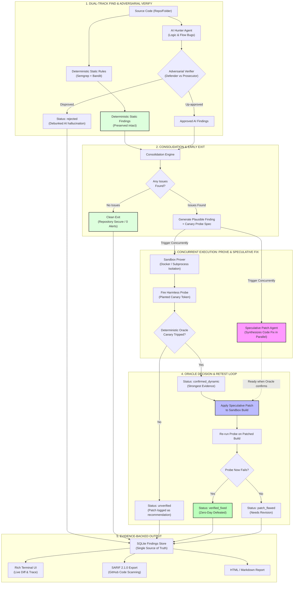

# ScanneX: Autonomous AppSec Verification & Speculative Remediation
**Team Gravitas (T2-13) • Official HackFest 2026 Submission**

[](https://www.python.org/downloads/)
[](https://oasis-open.github.io/sarif-spec/)
[](#honest-by-design-status-ontology)

> **Every other AppSec scanner stops at *"possible SQL injection, line 42"*. ScanneX tests whether it is real, proves it with a deterministic canary oracle, and synthesizes a verified fix in parallel.**

---

## The Core Problem & Our Breakthrough

Traditional Static Application Security Testing (SAST) tools generate overwhelming alert fatigue—flooding engineers with speculative warnings where 70%+ turn out to be unreachable, guarded, or false positives. Developers spend weeks manually triaging alerts, and the Mean Time To Remediation (MTTR) stretches into months.

### The ScanneX Innovations:
1. **Protected Dual-Track Scanning**:
   - **Track 1 (Static)**: Deterministic AST & taint rules (Bandit + Semgrep) are preserved intact—never discarded by LLM hallucinations.
   - **Track 2 (AI Hunter + Adversarial Gatekeeper)**: The AI Hunter scans for complex logic bugs and business-flow flaws. An **Adversarial AI Verifier** immediately cross-examines the Hunter's hypotheses (acting as prosecutor vs. defender) to debunk hallucinations *before* consolidation.
2. **Deterministic Canary Oracle (Zero-Trust Sandbox)**:
   - When a plausible vulnerability is identified, ScanneX synthesizes an isolated canary probe spec.
   - The application boots in an isolated Docker container (with dynamic-port subprocess fallback).
   - A **deterministic oracle**—never the LLM—decides whether the planted canary tripped (`confirmed_dynamic`). The LLM never gets a shell or network execution privileges.
3. **Concurrent Speculative Remediation**:
   - Dynamic sandbox provisioning and HTTP warmup take 15–30 seconds. Instead of waiting sequentially, ScanneX dispatches the **Speculative Patch Agent** in parallel the moment the finding is approved!
   - By the time the sandbox confirms exploitability, the candidate patch is already drafted.
   - The patch is immediately hot-applied to the sandbox and re-probed (`verified_fixed`).

---

## System Architecture



---

## Honest-by-Design Status Ontology

ScanneX never sweeps ambiguity under the rug or labels unproven alerts as "false positives":

| Status Code | Meaning | Evidence Required |
| :--- | :--- | :--- |
| `verified_fixed` | Flaw proven live & patch verified | Canary tripped on unpatched app; probe failed on patched app |
| `confirmed_dynamic` | Confirmed via live execution | Planted canary token observed in sandbox response or state |
| `confirmed_static` | Verified taint trace | Verified source-to-sink path without dynamic repro |
| `needs_validation` | Plausible suspicion | Logic inconsistency found; probe spec pending execution |
| `unverified` | Probe failed to trip canary | Benign probe did not trip canary (surfaces uncertainty honestly) |
| `rejected` | Debunked by Verifier | Evidence of sanitization, dead code, or framework guards |

---

## Quickstart & Demo

### 1. Installation
Clone the repository and install dependencies in a virtual environment:
```bash
git clone https://github.com/team-gravitas/gravitas-t2-13.git
cd gravitas-t2-13

# Create venv and install
uv venv .venv
.\.venv\Scripts\activate   # Or source .venv/bin/activate on Linux/macOS
uv pip install -e .
```

### 2. Run the One-Command Retrospective Demo
Evaluate ScanneX cold on our bundled pre-patch benchmark application (featuring authentic SQLi, Command Injection, and SSTI vulnerabilities):
```bash
python -m scannex.cli demo
```
**What happens in the demo:**
1. Scans the pre-patch target with Bandit AST rules.
2. AI Hunter discovers logic vulnerabilities; Adversarial Verifier audits hypotheses.
3. Spawns isolated ephemeral sandbox with free OS port allocation.
4. Concurrently executes dynamic canary probes and speculative patch synthesis.
5. Deterministic oracle confirms exploit (`confirmed_dynamic`).
6. Hot-patches the sandbox copy and re-probes to confirm vulnerability defeat (`verified_fixed`).
7. Emits interactive Rich terminal table, syntax-highlighted unified diffs, and standard `scannex-demo-report.sarif`.

### 3. Scan Any Repository or Codebase
```bash
# Offline zero-key scan (fast evaluation mode)
python -m scannex.cli scan /path/to/repo --mock

# Live LLM scan with Gemini or local Ollama
export GEMINI_API_KEY="your-api-key"
python -m scannex.cli scan /path/to/repo --model gemini/gemini-2.5-flash

# Using local Ollama
python -m scannex.cli scan /path/to/repo --model ollama/codellama
```

### 4. Run the Full Test Suite
```bash
python -m pytest tests/ -v
```

---

## Export Formats
- **SARIF 2.1.0** (`scannex-report.sarif`): Fully compliant with GitHub Security tab code scanning and CI/CD upload actions.
- **Markdown Report** (`scannex-report.md`): Clean summary table and audit evidence trail for pull request comments.
- **HTML Report** (`scannex-report.html`): Self-contained visual report with status badges and diff views.
- **SQLite Database** (`.scannex/findings.db`): Single source of truth with complete forensic traces.

---

## Team Gravitas (T2-13)
- Built for HackFest 2026.
- Architecture credit: Find-Prove-Fix pattern and Cloudflare finder/verifier inspiration.
